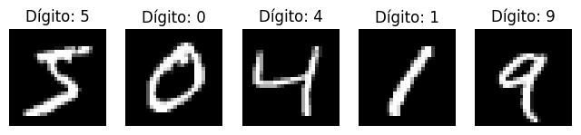
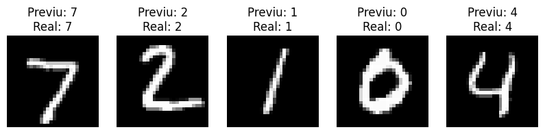

# Reconhecimento de Dígitos Escritos à Mão com CNN (MNIST)

Projeto acadêmico individual da disciplina de **Deep Learning**, do curso de Tecnologia em Banco de Dados da Faculdade de Tecnologia e Inovação Senac-DF.

[](https://colab.research.google.com/github/DanielNego/cnn-classificacao-imagens/blob/main/notebooks/cnn_mnist.ipynb)

## 🎯 Objetivo

Implementar em Python uma Rede Neural Convolucional (CNN) simples que reconhece dígitos de 0 a 9 escritos à mão, com foco em entender e explicar como o algoritmo aprende a reconhecer imagens.

## 🧠 Como funciona uma CNN (resumo)

Uma CNN é um tipo de rede neural usada principalmente para imagens. Ela funciona em etapas:

1. **Camadas convolucionais:** filtros pequenos percorrem a imagem para detectar padrões, como bordas, curvas e traços.
2. **Pooling:** reduz o tamanho da imagem mantendo as informações mais importantes.
3. **Camadas densas:** usam essas características para decidir a qual dígito a imagem corresponde.

## 📊 Dados

- **Base:** MNIST, com 70 mil imagens de dígitos de 0 a 9.
- **Imagens:** 28x28 pixels, em tons de cinza.
- **Divisão:** 60 mil imagens de treino e 10 mil de teste.
- **Preparação:** os pixels (0 a 255) foram divididos por 255 para ficarem entre 0 e 1, e foi adicionado o canal da imagem (1 = tons de cinza).



## 🏗️ Modelo

```
Conv2D (32 filtros 3x3, ReLU) → MaxPooling (2x2)
→ Conv2D (64 filtros 3x3, ReLU) → MaxPooling (2x2)
→ Flatten → Dense (64, ReLU) → Dense (10, Softmax)
```

- **Otimizador:** Adam
- **Função de perda:** sparse categorical crossentropy
- **Métrica:** acurácia
- **Épocas:** 5
- **Validação:** 10% dos dados de treino (`validation_split=0.1`)

## 📈 Resultados

- **Acurácia no conjunto de teste (10 mil imagens que o modelo não viu no treino):** [ajuste: valor exibido pelo notebook, ex.: 98,9%]

O notebook também mostra previsões do modelo em imagens novas, comparando o dígito previsto com o real:



## 🛠️ Tecnologias

- Python
- TensorFlow / Keras
- NumPy
- Matplotlib
- Google Colab

## ▶️ Como executar

**No Google Colab:** clique no botão "Abrir no Colab" no topo desta página e execute as células em ordem (Ambiente de execução → Executar tudo).

**No computador:**
```bash
git clone https://github.com/DanielNego/cnn-classificacao-imagens.git
cd cnn-classificacao-imagens
pip install -r requirements.txt
```
Depois, abra o notebook `notebooks/cnn_mnist.ipynb` com o Jupyter ou o VS Code.

## 📁 Estrutura do repositório

```
cnn-classificacao-imagens/
├── README.md
├── requirements.txt
├── notebooks/
│   └── cnn_mnist.ipynb    ← Notebook da CNN
└── images/                ← Imagens usadas neste README
```

## 👤 Autor

Daniel Reis Rodrigues — [LinkedIn](https://www.linkedin.com/in/daniel-reis-rodrigues/)

## ℹ️ Observações

Projeto com fins acadêmicos e educacionais. O MNIST é uma base clássica e simples, usada para aprender e demonstrar o funcionamento de redes neurais.
